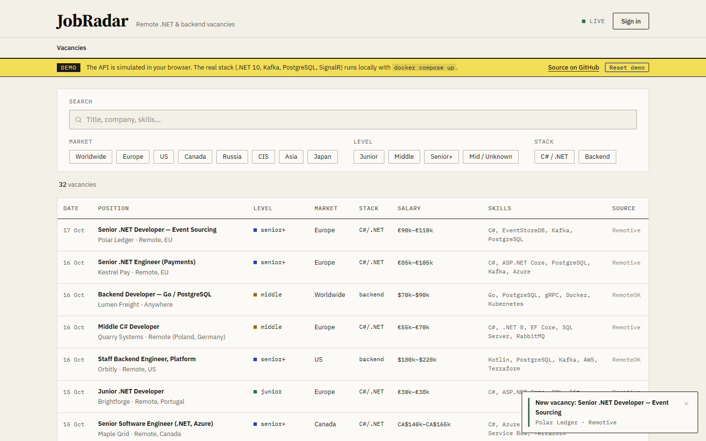

# JobRadar

[](https://github.com/GomenAmonai/JobFinder/actions/workflows/ci.yml)


Агрегатор remote-вакансий для .NET / backend-разработчиков **+** трекер откликов
кандидата **+** кабинет работодателя, с обновлениями в реальном времени.
Коллекторы → Kafka → идемпотентный .NET-воркер → PostgreSQL → REST + SignalR → React.

**[▶ Live demo](https://job-finder-eight-cyan.vercel.app)**: работает без бэкенда, API
эмулируется прямо в браузере. Вход демо-кандидатом или демо-работодателем в один клик.
Полный стек поднимается локально через `docker compose up` ([Запуск](#запуск)).

<picture>
  <source media="(prefers-color-scheme: dark)" srcset="docs/screenshots/feed-dark.png">
  
</picture>

### На что посмотреть

- **Идемпотентный приём под конкуренцией.** 50 параллельных писателей дают 1 строку и
  ровно 1 INSERT: update-first upsert + уникальный индекс + повтор на `23505`
  ([тест](tests/JobRadar.IntegrationTests/VacancyUpsertConcurrencyTests.cs)).
- **Event-driven, разные процессы.** Worker и API связаны только через Kafka
  (`vacancies.changed`), live-лента доходит до браузера по SignalR, битые сообщения
  уходят в dead-letter топик.
- **Безопасность.** Ротация refresh-токенов с инвалидацией всей цепочки при reuse
  (RFC 9700), скоупинг по пользователю (нет IDOR), rate limiting, проверка по
  OWASP API Security Top 10.
- **Optimistic concurrency** на системном столбце `xmin`: устаревшая версия даёт `409`,
  а не тихую перезапись.
- **79 тестов в CI:** 27 unit + 52 integration на реальном PostgreSQL (Testcontainers).

**Стек:** .NET 10 · ASP.NET Core (Minimal API + SignalR) · EF Core 10 + PostgreSQL ·
Kafka (Confluent.Kafka, KRaft) · OpenTelemetry · Clean Architecture · React + Vite +
TypeScript + TanStack Query · Docker Compose · xUnit + Testcontainers · GitHub Actions.

---

## Что это

Коллекторы на разных языках складывают сырьё в Kafka → .NET-воркер идемпотентно
нормализует и сохраняет его в Postgres → REST API отдаёт вакансии с фильтрами →
новые/изменённые вакансии и изменения статусов прилетают в SPA по SignalR.

Три роли в одном продукте:

- **Гость** — публичная лента вакансий с фильтрами (рынок/грейд/стек/поиск), live-обновления.
- **Кандидат** — JWT-аккаунт, сохранённые фильтры, отклик на вакансию, личный
  пайплайн откликов (state-machine статусов), live-уведомления о матчах.
- **Работодатель** — постит нативные вакансии на JobRadar, видит входящие отклики
  (с контактами кандидатов), двигает их по стадиям — кандидат получает push.

> Вакансии агрегируются с внешних бордов, поэтому «настоящий отклик» имеет смысл
> только для нативных (запощенных работодателем) вакансий. По агрегированным отклик —
> это личный трекер кандидата. Это «гибрид»: трекер + посредник в одной модели.

## Showpiece: идемпотентный приём под конкуренцией

Одна и та же вакансия приходит повторно и одновременно из нескольких источников/потребителей.
Гарантия — **ровно одна строка** на `(Source, ExternalId)`, без дублей и без потери апдейтов:

- Уникальный индекс `(Source, ExternalId)` физически запрещает дубль.
- [`VacancyUpsertService`](src/JobRadar.Infrastructure/Ingestion/VacancyUpsertService.cs)
  использует стратегию **update-first**: атомарный set-based `ExecuteUpdate`
  (не читает строку, не штормит ретраями под нагрузкой), а на гонке вставки ловит
  нарушение уникального индекса (Postgres `23505`) и повторяет цикл.
- Optimistic concurrency через системный столбец `xmin` задействован там, где он уместен —
  на интерактивных правках (сохранённые фильтры, смена статуса отклика): устаревшая
  клиентская версия даёт `409`, а не тихую перезапись.

Проверяется тестом [`VacancyUpsertConcurrencyTests`](tests/JobRadar.IntegrationTests/VacancyUpsertConcurrencyTests.cs):
**50 конкурентных писателей → 1 строка, ровно 1 INSERT.**

## Архитектура

```
[ Коллекторы ]            [ Kafka ]                  [ .NET ]                     [ Клиент ]
 RemotiveCollector ─push─► vacancies.raw ──► Worker: VacancyConsumer
 RemoteOkCollector                          ├─ нормализация (рынок/грейд/стек,
 (+ Python-скрейперы)                       │   парсинг зарплат, dedup-ключ)
                                            ├─ идемпотентный upsert ──────► Postgres
                                            ├─ ошибки ──► vacancies.dead-letter
                                            └─ publish ─► vacancies.changed
                                                               │
                                          Api: VacancyChangedConsumer ◄┘
                                            └─ IHubContext ─► SignalR ─► React (live)
                                          Api: REST (/vacancies, /auth, /me, /employer)
                                            └─────────────────────────────► React SPA
```

Worker и Api — **разные процессы**, поэтому live-обновления идут через Kafka-бэкплейн
(`vacancies.changed`), а не in-process: воркер не знает о SignalR, API не знает о приёме.

**Слои (Clean Architecture, зависимости внутрь):**

- `JobRadar.Domain` — сущности (`Vacancy`, `User`, `JobApplication`, `SavedFilter`, …)
  и чистая доменная логика (`ApplicationStatusTransitions` — state-machine статусов).
- `JobRadar.Application` — контракты, DTO, интерфейсы, нормализация
  (`VacancyNormalization`, `SalaryParser`, `DedupKeyBuilder`).
- `JobRadar.Infrastructure` — EF Core, миграции, сервисы (upsert, auth, фильтры, отклики, employer).
- `JobRadar.Api` — Minimal API + SignalR-хаб + OpenAPI/Scalar + JWT + rate limiting + OpenTelemetry.
- `JobRadar.Worker` — Kafka consumer + C#-коллекторы (BackgroundService, Polly).
- `frontend/` — React + Vite + TS SPA (TanStack Query + `@microsoft/signalr`).

## API

Полный интерактивный справочник — Scalar UI на `GET /scalar/v1` (в Development).

| Метод | Маршрут | Доступ |
|---|---|---|
| `GET` | `/vacancies?market=&level=&stack=&q=&page=&pageSize=` | публично |
| `POST` | `/auth/register` · `/auth/login` · `/auth/refresh` | публично (rate-limited) |
| `GET` | `/auth/me` | auth |
| `GET/POST/PUT/DELETE` | `/me/filters[/{id}]` | auth |
| `POST` | `/vacancies/{id}/applications` | auth |
| `GET/PATCH/DELETE` | `/me/applications[/{id}][/status]` | auth |
| `POST` | `/employer/vacancies` | роль `Employer` |
| `GET` | `/employer/applications` | роль `Employer` |
| `PATCH` | `/employer/applications/{id}/status` | роль `Employer` |
| `GET` | `/hubs/vacancies` | SignalR (токен в `?access_token=`) |

**SignalR-события (сервер → клиент):** `VacancyChanged` (всем — live-лента),
`MatchedVacancy` (таргетированно — новая вакансия под сохранённым фильтром),
`ApplicationStatusChanged` (таргетированно — работодатель сменил статус отклика).

## Безопасность и прод-готовность

- **JWT** (HS256): валидация issuer/audience/lifetime/подписи; refresh-токены опаковые,
  в БД только SHA-256 хеш, ротация с **инвалидацией всей цепочки при reuse** (RFC 9700).
- **Авторизация:** эндпоинты скоупятся по пользователю (нет BOLA/IDOR); `/employer/*`
  под `RequireRole("Employer")` — покрыто HTTP-тестами (anon 401 / candidate 403 / employer 200).
- **Хардening (вне Development):** `UseExceptionHandler` + ProblemDetails (без stack-trace),
  HSTS + HTTPS-redirect, fail-fast на дев/слабом JWT-ключе, security-заголовки
  (nosniff/frame-options/referrer), CORS origins из конфигурации.
- **Rate limiting:** `/auth/*` 10/мин/IP, `/vacancies` 120/мин/IP.
- **Защита от DoS:** LIKE-экранирование + лимит длины поиска, пагинация ≤ 100, лимит длины пароля.
- **Надёжность приёма:** at-least-once Kafka + идемпотентный upsert; необработанные
  сообщения уходят в **dead-letter** топик, а не теряются.
- **Наблюдаемость:** OpenTelemetry (traces + metrics: ASP.NET / HttpClient / Npgsql / runtime),
  экспорт по OTLP при заданном `OTEL_EXPORTER_OTLP_ENDPOINT`.

Прошло state security-аудит по OWASP API Security Top 10 (BOLA, broken auth, BOPLA,
resource consumption, function-level authz, SSRF, misconfiguration).

## Запуск

Требуется Docker и .NET 10 SDK (репозиторий пинит версию через `global.json`).

```bash
# 1. Инфраструктура: Postgres (host-порт 5433) + Kafka (+ kafka-ui на :8080)
docker compose up -d

# 2. Применить миграции
dotnet ef database update -p src/JobRadar.Infrastructure -s src/JobRadar.Api

# 3. Воркер: коллекторы → Kafka → Postgres → vacancies.changed
dotnet run --project src/JobRadar.Worker

# 4. API (REST + SignalR; Scalar UI на /scalar/v1) — на http://localhost:5088
dotnet run --project src/JobRadar.Api

# 5. Фронт — на http://localhost:5173
cd frontend && npm install && npm run dev
```

Фронт ходит в API по `VITE_API_URL` (по умолчанию `http://localhost:5088`) — см. `frontend/env.example`.

> Локальные dev-значения (Postgres-креды, JWT-ключ в `appsettings`) — throwaway, в git
> только для разработки. Перед реальным деплоем: секреты в env/secret-store, верификация
> работодателя (сейчас роль self-service — демо), TTL/retention вакансий (требует смены
> cascade-FK), обработчик/реплей dead-letter.

## Деплой

Контейнеры для всех сервисов готовы: `src/JobRadar.Api/Dockerfile`,
`src/JobRadar.Worker/Dockerfile`, `frontend/Dockerfile` (multi-stage, .NET 10 / Node).
API биндится на `$PORT` и опционально накатывает миграции на старте
(`RunMigrationsOnStartup=true`). Пошаговый план для Railway (5 сервисов, переменные,
Kafka, порядок) — в [DEPLOY.md](DEPLOY.md).

## Тесты

```bash
dotnet test tests/JobRadar.UnitTests          # быстрые, без Docker (27)
dotnet test tests/JobRadar.IntegrationTests   # Testcontainers, нужен Docker (52)
```

Оба набора и сборка фронта (`tsc` + `vite build`) гоняются в GitHub Actions на каждый
push и PR: [`.github/workflows/ci.yml`](.github/workflows/ci.yml).

- **Unit (27):** чистая доменная/прикладная логика — нормализация, парсинг зарплат,
  dedup-ключ, релевантность, state-machine статусов, маппинг.
- **Integration (52):** реальный Postgres через Testcontainers — идемпотентный upsert
  под конкуренцией, query/дедуп, auth + ротация refresh, сохранённые фильтры (xmin-конфликт),
  отклики, employer-сценарии (IDOR-скоупинг), и HTTP-level role-enforcement через
  `WebApplicationFactory`.

## Frontend

SPA на React + Vite + TS: публичная лента с фильтрами, авторизация (login/register),
сохранённые фильтры, отклик + доска статусов, сторона работодателя, live через SignalR.
Данные — TanStack Query (кэш, инвалидация по SignalR), доступ к API — типизированный
клиент с авто-refresh токена. Стили на чистом CSS без UI-библиотек: дизайн-токены
в `frontend/src/styles/tokens.css` (светлая и тёмная схема по настройке ОС), плотная
таблица вакансий, которая на узких экранах складывается в карточки.

### Демо-режим

Чтобы статический деплой фронта не показывал пустой экран без API, есть демо-режим:
[`frontend/src/api/demo/server.ts`](frontend/src/api/demo/server.ts) отвечает на те же
маршруты, что и настоящий API (коды ответов, версии для `409`, state-machine откликов,
роль `Employer`), а состояние хранит в `localStorage`. Симулированный воркер раз в
~25 секунд «находит» вакансию и шлёт те же события, что SignalR-хаб (`VacancyChanged`,
`MatchedVacancy`, `ApplicationStatusChanged`). Код компонентов не знает, в каком режиме
он работает: подменяется только транспорт в `api/http.ts`.

| Сборка | Режим |
|---|---|
| `npm run dev` | реальный API на `VITE_API_URL` (по умолчанию `http://localhost:5088`) |
| `npm run build` с `VITE_API_URL` | реальный API |
| `npm run build` без `VITE_API_URL` | демо (так собирается Vercel-деплой) |
| `VITE_DEMO_MODE=true` / `false` | принудительно включить / выключить |
